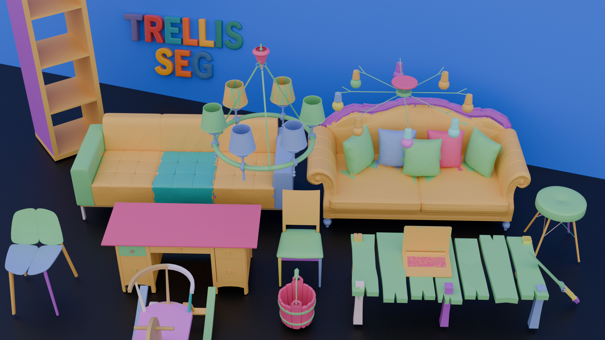
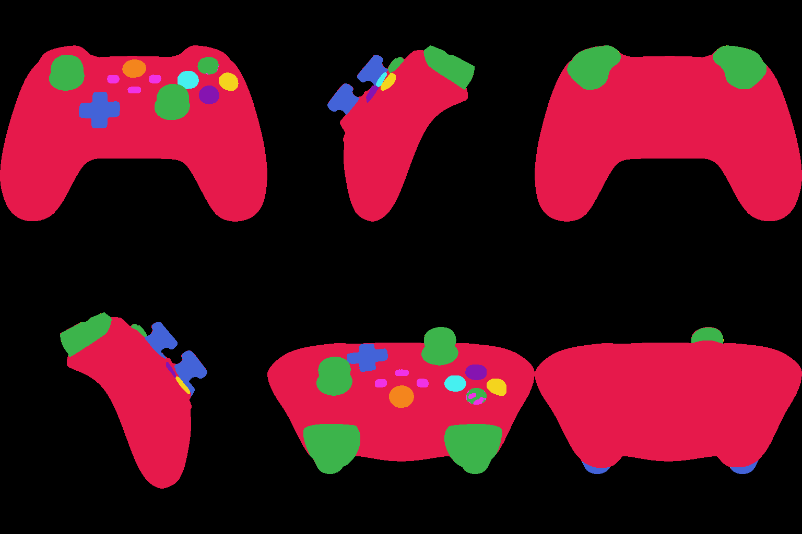
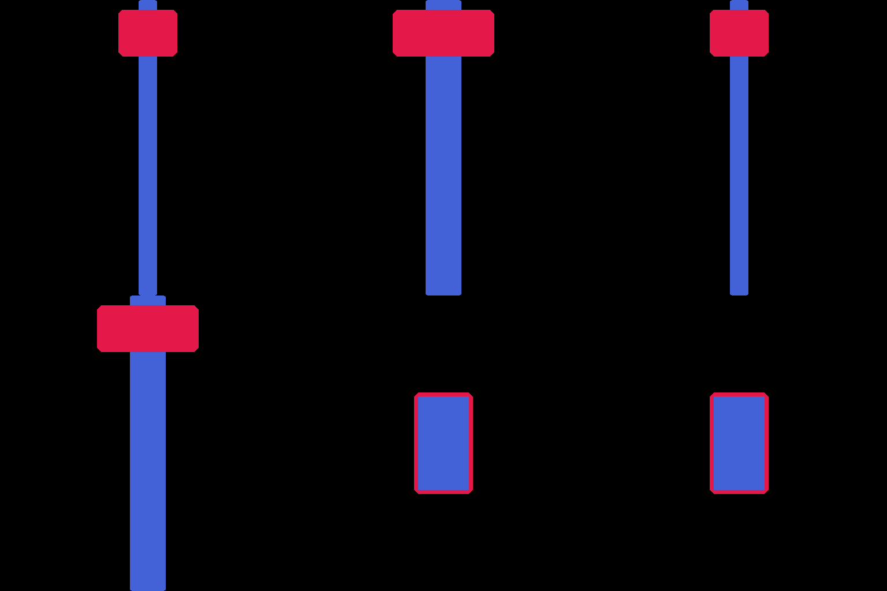
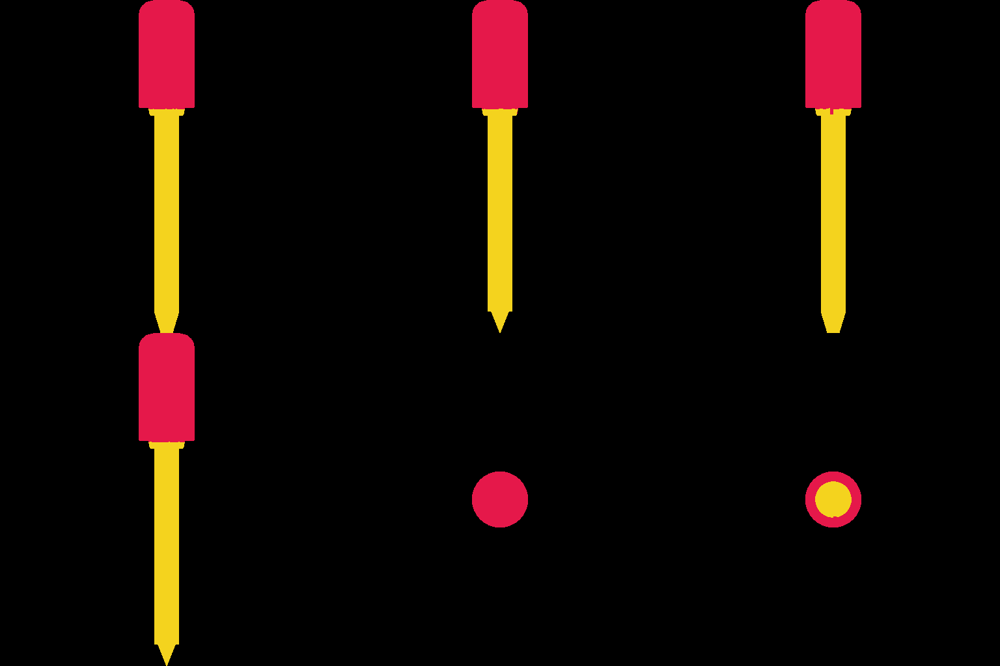
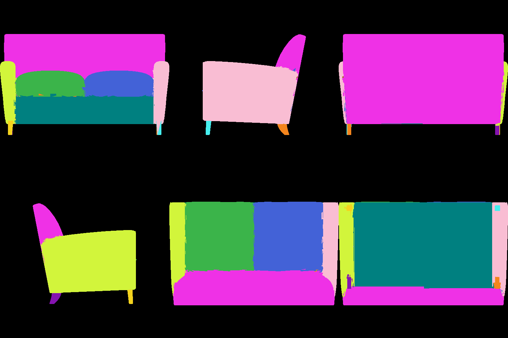

# Trellis SegPart

<p align="center">
  
</p>

3D semantic segmentation generation built on [TRELLIS.2](https://github.com/microsoft/TRELLIS.2). Given a 3D mesh and multi-view segmentation maps, the model generates per-voxel part labels in the TRELLIS latent space using flow matching.

## Demo Results

👉 [**View Interactive Demo (Segmentation + 3D Mesh)**](https://yixinzhu042.github.io/Trellis_Seg/demo/index.html)

<p align="center">
  
  
  
  
</p>

## News

**2026.7.10: Initial code has been released.**

**2026.7.14: Add code for repurposing texture VAE to encode discrete segmentation labels due to original vae not being suitable to encode discrete labels.** (We also tried to first map discrete labels into RGB, and then ultilize the texture VAE to encode the RGB image directly, but it did not work well.)

**2026.7.15: The ckpt of segmentation VAE has been access in [HuggingFace](https://huggingface.co/GilgameshYX/Trellis_segPart).**

**2026.07.16: The denoising DiT for segmentation has been available in [HuggingFace](https://huggingface.co/GilgameshYX/Trellis_segPart).**

## Architecture

| Component | Model | Purpose |
|-----------|-------|---------|
| **Seg VAE** | SparseUnetVaeEncoder/Decoder (20ch ↔ 32ch) | Encode/decode 20-class segmentation labels in 512³ sparse voxels |
| **DIT** | ElasticSegSLatFlowModel (1.3B, 30 blocks) | Flow matching on seg latent, conditioned on shape + multi-view seg |
| **Image Cond** | DINOv3-ViT-L/16 | Extract global features from a reference view for cross-attention |

### Data Flow

```
Input: mesh + 6-view segmentation maps
                │
                ├─→ Voxelize → Seg VAE encode ────→ spatial cache (for decode)
                │                                    + latent coords (DIT operates here)
                │
                ├─→ Shape VAE encode ─────────────→ shape_slat (32ch) → concat_cond
                │
                ├─→ Seg views → one-hot → Seg VAE encode → mv_seg_slat ─→ cross-attention
                │
                └─→ Colorized front seg view → DINOv3 ──────────────────→ cross-attention
                                                              │
                                                        noise (32ch)
                                                              │
                                                        Flow Matching DIT
                                                              │
                                                              ▼
                                          seg_slat (32ch) → Seg VAE decode → per-voxel labels
```

## Project Structure

```
trellis_segpart/
├── configs/
│   ├── seg_vae_train.json              # Seg VAE fine-tuning config
│   └── slat_flow_seg_dit_1_3B_512_bf16.json  # DIT training config
├── datasets/
│   ├── seg_dataset.py                  # DIT training dataset
│   └── seg_vae_dataset.py             # Seg VAE training dataset
├── models/
│   └── seg_flow_model.py             # ElasticSegSLatFlowModel
├── trainers/
│   ├── seg_trainer.py                 # DIT flow matching trainer
│   └── seg_vae_trainer.py            # Seg VAE fine-tuning trainer
├── preprocess/                        # Data preprocessing pipeline
│   ├── step1_render_seg_views.py
│   ├── step2_encode_mv_seg_latent.py
│   ├── step3_encode_shape_latent.py
│   ├── step4_encode_seg_latent.py
│   ├── step4b_save_seg_voxels.py     # Save raw voxels for VAE training
│   └── step5_render_cond_images.py
├── train.py                           # Training entry point
├── inference.py                       # Inference pipeline
└── scripts/                           # Launch scripts
```

## Prerequisites

- Python 3.10+
- PyTorch 2.x with CUDA
- [TRELLIS.2](https://github.com/Microsoft/TRELLIS) cloned at `../TRELLIS.2`
- `o_voxel` (for mesh voxelization in Step 3)
- Pre-trained TRELLIS.2 checkpoints (Texture VAE, Shape VAE, Shape DIT)

## Data Preprocessing

The pipeline converts PartNeXt meshes with per-face part annotations into latent representations:

| Step | Script | Output | Description |
|------|--------|--------|-------------|
| 1 | `step1_render_seg_views.py` | `seg_views/` | Render 6 orthographic seg maps |
| 2 | `step2_encode_mv_seg_latent.py` | `mv_seg_latent/` | Encode multi-view seg → Texture VAE latent (condition) |
| 3 | `step3_encode_shape_latent.py` | `shape_latent/` | Encode mesh geometry → Shape VAE latent (condition) |
| 4 | `step4_encode_seg_latent.py` | `seg_latent/` | Encode 3D seg labels → Texture VAE latent (target x₀) |
| 4b | `step4b_save_seg_voxels.py` | `seg_voxels/` | Save raw voxelized labels for Seg VAE training |
| 5 | `step5_render_cond_images.py` | `render_cond/` | Render reference image for DINO conditioning |

### Quick Start (smoke test)

```bash
bash preprocess/run_all.sh
```

### Multi-GPU Parallel Processing

Steps 2–4 support `--rank` and `--world_size` for data-parallel preprocessing:

```bash
for rank in 0 1 2 3; do
    CUDA_VISIBLE_DEVICES=$rank python preprocess/step2_encode_mv_seg_latent.py \
        --data_dir ./data --rank $rank --world_size 4 &
done
wait
```

## Training

### Stage 1: Seg VAE Fine-tuning

Fine-tunes the pre-trained Texture VAE (6ch RGB → 20ch one-hot labels) to encode/decode segmentation in the same latent space.

```bash
python train.py \
    --config configs/seg_vae_train.json \
    --output_dir ./experiments/seg_vae \
    --data_dir /path/to/data \
    --num_gpus 8
```

Key details:
- Input/output channels expanded from 6 → 20 (one-hot segmentation labels)
- Latent remains 32ch on a 32³ grid
- Loss: cross-entropy + KL (λ=1e-5)
- Initialized from pre-trained Texture VAE weights (first 6 channels preserved)

### Stage 2: DIT Training

Trains the flow matching DIT to generate seg latent conditioned on shape + multi-view seg + reference image.

```bash
python train.py \
    --config configs/slat_flow_seg_dit_1_3B_512_bf16.json \
    --output_dir ./experiments/seg_dit \
    --data_dir /path/to/data \
    --num_gpus 8
```

Key details:
- 1.3B parameter DiT (30 blocks, 1536 model channels, 12 heads)
- Input: 64ch (32ch noise + 32ch shape_latent concatenated; mv_seg_latent via cross-attention or concat)
- Output: 32ch velocity prediction
- Conditioning: DINOv3 features via cross-attention
- Elastic memory management for variable token counts
- Fine-tuned from TRELLIS.2 shape→texture DIT checkpoint

## Inference

### In-the-Wild Inference (New Mesh)

Full pipeline: mesh → render views → 2D segmentation → 3D generation → colored mesh.

#### Step 1: Render 6 Orthographic Views

```bash
python scripts/render_views.py \
    --mesh /path/to/input.glb \
    --output_dir ./results/my_model_renders
```

Output: `front.png`, `right.png`, `back.png`, `left.png`, `top.png`, `bottom.png` (512×512, white background).

#### Step 2: 2D Segmentation via API

```bash
python scripts/segment_views_via_api.py \
    --input_dir ./results/my_model_renders \
    --output_dir ./results/my_model_seg
```

Output: `seg_maps.npz` with `seg_maps: (6, 512, 512) int32` where:
- `0` = background (no mesh visible)
- `1, 2, 3, ...` = part labels

**Important**: Background pixels must be labeled `0`. The segmentation model should only assign part labels to pixels where the mesh is visible. Background pollution will corrupt the multi-view conditioning.

#### Step 3: Run 3D Segmentation Inference

```bash
python scripts/inference_wild.py \
    --mesh /path/to/input.glb \
    --seg_maps ./results/my_model_seg/seg_maps.npz \
    --output ./results/my_model_result.glb \
    --steps 50
```

The inference pipeline:
1. **Voxelize mesh** (512³ grid) → Seg VAE encoder → establish spatial cache + latent coords
2. **Encode shape** via Shape VAE → shape_slat → lookup at seg latent coords → `concat_cond`
3. **Encode multi-view seg** → one-hot on box surface → Seg VAE encoder → `mv_cond` (cross-attention)
4. **DINOv3 conditioning** from colorized front seg view
5. **DIT flow matching sampling** (50 steps) → seg_slat features
6. **Seg VAE decoder** (using encoder's spatial cache) → 20ch logits → argmax → per-voxel labels
7. **Bake onto mesh** faces via KDTree nearest neighbor → export colored GLB

### Batch Inference on Training Data

```bash
python scripts/batch_inference.py \
    --num_samples 10 \
    --output_dir ./batch_results \
    --steps 50
```

Outputs `{instance}.glb` (prediction) and `{instance}_gt.glb` (ground truth decode) per sample.

## Configuration

### Seg VAE (`configs/seg_vae_train.json`)

| Parameter | Value | Note |
|-----------|-------|------|
| `in_channels` / `out_channels` | 20 | One-hot segmentation classes |
| `latent_channels` | 32 | Same as original Texture VAE |
| `resolution` | 512 | Input voxel grid (→ 32³ latent) |
| `max_tokens` | 30000 | Max voxels per sample |
| `lr` | 1e-5 | Fine-tuning learning rate |
| `lambda_kl` | 1e-5 | KL regularization weight |

### DIT (`configs/slat_flow_seg_dit_1_3B_512_bf16.json`)

| Parameter | Value | Note |
|-----------|-------|------|
| `in_channels` | 64 | 32ch noise + 32ch shape condition |
| `out_channels` | 32 | Velocity prediction |
| `model_channels` | 1536 | Hidden dimension |
| `num_blocks` | 30 | Transformer blocks |
| `cond_channels` | 1024 | DINOv3 feature dimension |
| `max_tokens` | 8192 | Max latent tokens per sample |
| `lr` | 1e-4 | With linear warmup (1000 steps) |

## Output Data Layout

```
{data_dir}/
├── seg_views/{instance}.npz         # (6, 512, 512) int32
├── mv_seg_latent/{instance}.npz     # coords(M,3) uint8 + feats(M,32) float32
├── shape_latent/{instance}.npz      # coords(M,3) uint8 + feats(M,32) float32
├── seg_latent/{instance}.npz        # coords(M,3) uint8 + feats(M,32) float32
├── seg_voxels/{instance}.npz        # coords(N,3) int32 + labels(N,) int64
└── render_cond/{instance}.png       # RGBA 512×512
```

## License

This project is released under the [MIT License](LICENSE).
