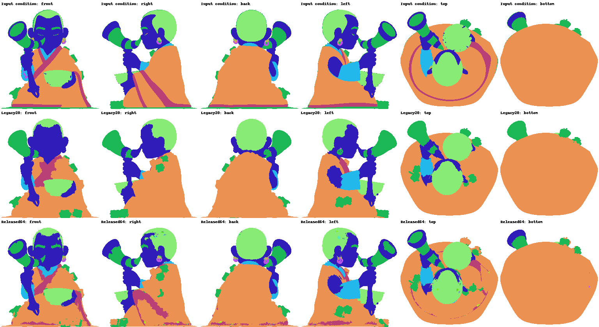
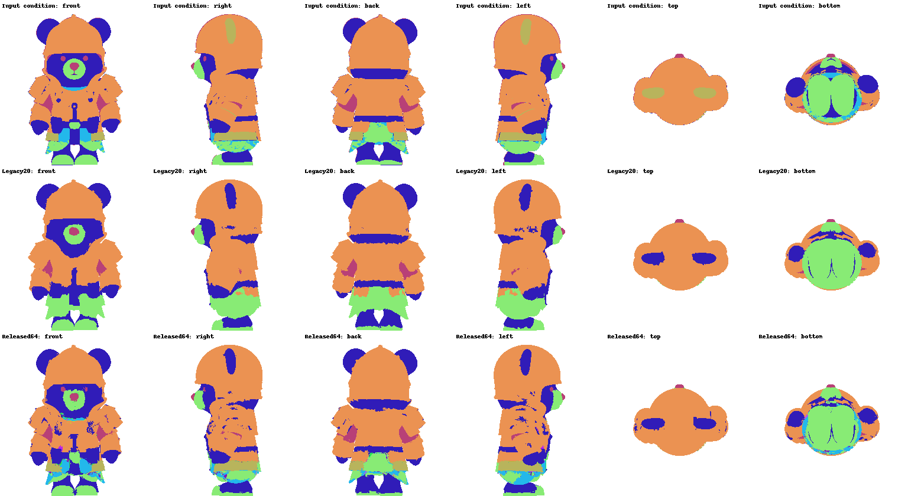
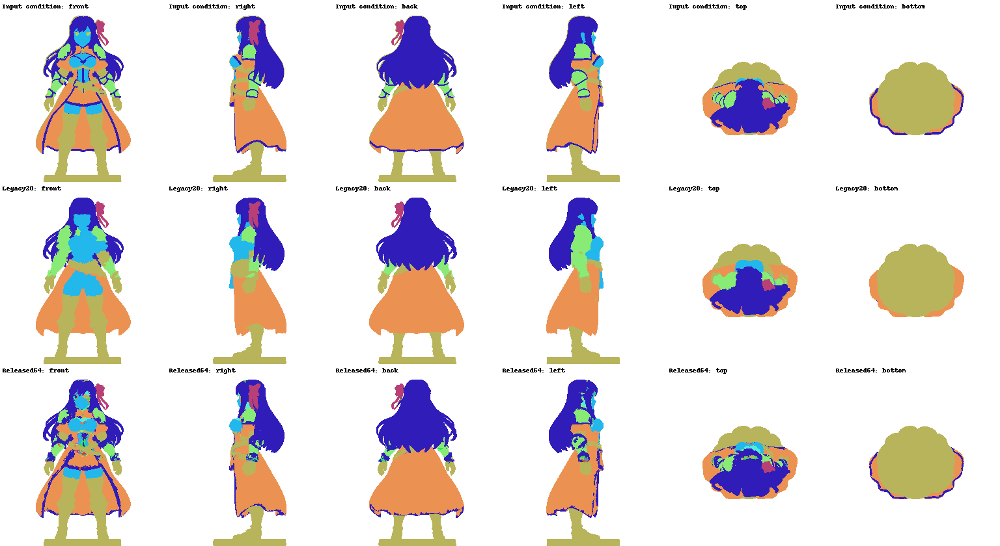
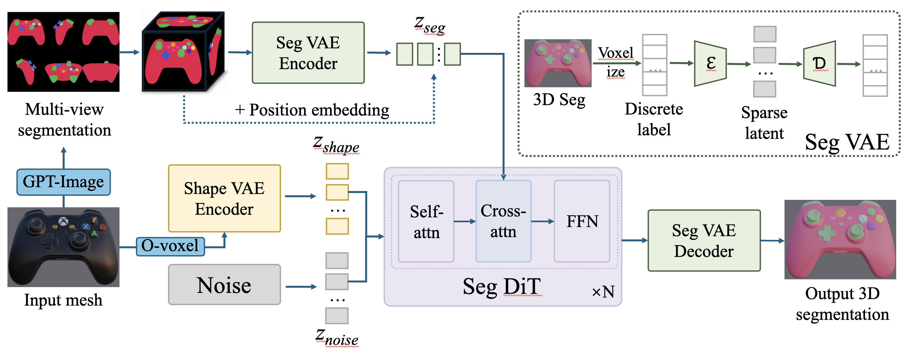

# Trellis SegPart

<p align="center">
  
</p>

3D part segmentation generation built on [TRELLIS.2](https://github.com/microsoft/TRELLIS.2). Given known mesh geometry and multi-view segmentation conditions, the model generates segmentation latents using flow matching and decodes them into voxel and surface part labels.

## Latest release — 2026-10-09: VAE parts64 + DiT B + small-part optimization

**Start with the [parts64 release guide](docs/parts64_release.md)** for checkpoint loading, data contracts, training methodology, and evaluation limits. The current implementation uses `vae_v2/` and the v2 training/evaluation scripts. These are research pipelines built around audited caches; this release does **not** provide turnkey v2 inference on arbitrary meshes or photographs. `scripts/inference_wild.py` remains a legacy **20-class** workflow.

Use the following pair from [GilgameshYX/Trellis_segPart on Hugging Face](https://huggingface.co/GilgameshYX/Trellis_segPart/tree/a5e92a02738ea0ef741053a863a9cf53b007cf9b/releases/parts64_20261009), pinned to revision **`a5e92a02738ea0ef741053a863a9cf53b007cf9b`**:

| Component | Exact file in the Hugging Face repository |
| --- | --- |
| Segmentation VAE v2, regular step 9,500 | `releases/parts64_20261009/vae/regular_step009500.pt` |
| Segmentation DiT, B EMA step 5,000 | `releases/parts64_20261009/dit/ema_step005000.pt` |

Download the companion configurations, normalization, and release manifest with the weights:

```bash
hf download GilgameshYX/Trellis_segPart \
  --revision a5e92a02738ea0ef741053a863a9cf53b007cf9b \
  --include 'releases/parts64_20261009/*' \
  --local-dir ./trellis_segpart_models
```

The **64 label channels include unknown/unannotated channel 0**, leaving at most 63 nonzero part IDs. IDs are **object-local**, not a shared semantic vocabulary. The learned latent still has **32 channels**. VAE v2 includes the encoder, decoder, and learned geometry-aware surface head. The evaluated DiT uses shape features and six-view segmentation latents with **1,029 zero image-placeholder tokens, not real DINO features**.

Both checkpoints were selected on 128 validation objects. VAE training reached step 10,000, but the released and evaluated pair uses **step 9,500**. Do not mix versions: use the matching v2 code, full VAE state, companion configs, geometry template, and training-only normalization together. Legacy 20-class weights, caches, normalization, and inference scripts are incompatible with this pair. Current weights live on Hugging Face, not in Git; training data, generated caches, optimizer states, logs, and runtime prediction artifacts are not shipped with the code release.

| Fixed 128-object development test | Previous paired DiT | B + small-parts DiT |
| --- | ---: | ---: |
| Surface mIoU | 83.58% | **85.05%** |
| Small-part recall | 57.03% | **60.61%** |
| Hidden-surface mIoU | 71.67% | **73.48%** |

Protocol: Gaussian start, **20 Euler steps, CFG=1 (no classifier-free guidance amplification)**, one fixed seed per object, original IDs, no label matching or postprocessing. Conditions are **GT-derived six-view segmentations and native shape features on known meshes**; these are not results from actual photographs or an external segmentation API. The test objects have already informed development, and historical initialization may have seen some objects: this is development regression evaluation, **not an independent blind test**. Small and numerous parts remain difficult, and some objects regress.

Further reading: [VAE losses](docs/seg_vae_v2_losses_explained.md), [corrected parts64 data and splits](docs/seg_vae_v2_parts64.md), [VAE label-permutation continuation](docs/seg_vae_v2_parts64_permute.md), [frozen-VAE DiT training](docs/dit_vae_v2_parts64.md), [B + small-part methodology](docs/dit_b_smallparts.md), and [October 9 evaluation report](docs/dit_b_smallparts_test_20261009.md). Experiment notes describe their recorded environment; local runtime artifacts linked from those notes are not bundled with this release.

## Interactive old / new comparison — 2026-10-09

👉 [**Open the comparison: 15 original demo meshes + 3 characters**](https://yixinzhu042.github.io/Trellis_Seg/demo/index.html)

👉 [**Open new-model raw vs geometry-only postprocessed outputs**](https://yixinzhu042.github.io/Trellis_Seg/demo/#sample=character1&mode=post)

The updated HTML provides side-by-side old/new GLBs, synchronized cameras, character filtering, shared input views, static comparisons, and downloads. Only the selected pair is loaded. The original GLBs and [historical page](demo/legacy.html) are preserved.

Both sides are controlled **reruns**: legacy 20-label VAE + DiT EMA step 50,000 versus VAE v2 parts64 regular step 9,500 + B DiT EMA step 5,000. They use identical geometry-only voxel samples, six-view label pixels, and Gaussian noise (seed 42, 20 Euler steps, CFG=1), with each model's trained normalization. No label matching, smoothing, or mesh decimation is applied. These reruns are not a claim of exact reproduction of the archived July predictions.

The following figures are **agreement with the supplied 2D conditions, not ground-truth segmentation accuracy**. The 15 original inputs retain legacy conditions; the three new character conditions were generated once per character by an external 2D segmentation API and shared between models.

| Demo cohort / character | Old condition mIoU | New condition mIoU | Change |
| --- | ---: | ---: | ---: |
| 15 original demos, object mean | 93.53% | 92.53% | −1.00 pp |
| Character 1 — seated monk | 45.72% | 65.15% | +19.43 pp |
| Character 2 — armored bear | 45.05% | 60.33% | +15.28 pp |
| Character 3 — fantasy warrior | 70.21% | 76.02% | +5.81 pp |

The character results improve on this condition-agreement measure, but regressions are retained: original demo 08 drops 18.57 pp and demo 10 drops 7.99 pp. New-model character outputs also contain small extra-label fragments, so higher agreement does not establish uniformly cleaner segmentation. See the [demo protocol and limitations](docs/demo_comparison_20261009.md).

### Geometry-only postprocessing

The page now also compares every new-model raw GLB with a separately downloadable postprocessed GLB. One global rule is used for all 18 development examples: merge same-label connected components below **0.05% of total mesh surface area** only when one neighboring label receives at least **80% weighted boundary support**, then apply one synchronous high-confidence boundary vote. Boundary support is weighted by adjacent-face area and normal agreement, reducing influence across sharp creases.

| Development demo cohort | Raw condition mIoU | Postprocessed condition mIoU | Label components |
| --- | ---: | ---: | ---: |
| 15 original demos | 92.53% | **93.08%** | 4,195 → 3,127 |
| 3 characters | 67.17% | **67.36%** | 15,310 → 4,058 |

Across these 18 examples, input-condition mIoU increased for 14, was unchanged for 4, and decreased for none; connected components fell from 19,505 to 7,185 while a mean 0.693% of surface area changed. These are observations on the same development cohort used to choose the single setting, **not held-out generalization results**. The transform itself is geometry-only: it does not read GT or the 2D condition, perform label matching, or replace 3D labels with projected labels. Raw outputs remain available and are never overwritten. See the [postprocessing method, per-object results, and limitations](docs/demo_postprocess_20261009.md).

<p align="center">
  <a href="https://yixinzhu042.github.io/Trellis_Seg/demo/#sample=character1"></a>
  <a href="https://yixinzhu042.github.io/Trellis_Seg/demo/#sample=character2"></a>
  <a href="https://yixinzhu042.github.io/Trellis_Seg/demo/#sample=character3"></a>
</p>

## News

**2026-10-09: Released the paired VAE parts64 v2 and B + small-part DiT checkpoints, with current training/evaluation code. See the [release guide](docs/parts64_release.md).**

The July announcements below describe the historical model family.

**2026.7.10: Initial code has been released.**

**2026.7.14: Add code for repurposing texture VAE to encode discrete segmentation labels due to original vae not being suitable to encode discrete labels.** (We also tried to first map discrete labels into RGB, and then ultilize the texture VAE to encode the RGB image directly, but it did not work well.)

**2026.7.15: The ckpt of segmentation VAE has been access in [HuggingFace](https://huggingface.co/GilgameshYX/Trellis_segPart).**

**2026.07.16: The denoising DiT for segmentation has been available in [HuggingFace](https://huggingface.co/GilgameshYX/Trellis_segPart).**

**2026.07.21: The modified architecture of DiT has been added and the new ckpt has been released in [HuggingFace](https://huggingface.co/GilgameshYX/Trellis_segPart).**

## Pipeline

<p align="center">
  
</p>

<p align="center">
  <em>Overview of the Trellis Seg pipeline: multi-view segmentation and shape latents condition a Seg DiT to generate 3D segmentation latents, which are decoded by the Seg VAE into per-part 3D labels.</em>
</p>

The diagram is retained as a conceptual overview. For the October 9 release, use the v2 surface decoder and the zero image-placeholder conditioning described above; the implementation details below are historical.

## Legacy architecture (July 2026, 20 classes)

All sections marked **Legacy** document the earlier 20-class code, configurations, data layout, and workflows. Use the [parts64 guide](docs/parts64_release.md) for the current release; changing only checkpoint paths in these examples does not migrate them to v2.

| Component | Model | Purpose |
|-----------|-------|---------|
| **Seg VAE** | SparseUnetVaeEncoder/Decoder (20ch ↔ 32ch) | Encode/decode 20-class segmentation labels in 512³ sparse voxels |
| **DIT** | ElasticSegSLatFlowModel (1.3B, 30 blocks) | Flow matching on seg latent, conditioned on shape + multi-view seg |
| **Image Cond** | DINOv3-ViT-L/16 | Extract global features from a reference view for cross-attention |

### Data Flow

```
Input: mesh + 6-view segmentation maps
                │
                ├─→ Voxelize → Seg VAE encode ────→ spatial cache (for decode)
                │                                    + latent coords (DIT operates here)
                │
                ├─→ Shape VAE encode ─────────────→ shape_slat (32ch) → concat_cond
                │
                ├─→ Seg views → one-hot → Seg VAE encode → mv_seg_slat ─→ cross-attention
                │
                └─→ Colorized front seg view → DINOv3 ──────────────────→ cross-attention
                                                              │
                                                        noise (32ch)
                                                              │
                                                        Flow Matching DIT
                                                              │
                                                              ▼
                                          seg_slat (32ch) → Seg VAE decode → per-voxel labels
```

## Legacy project structure

```
trellis_segpart/
├── configs/
│   ├── seg_vae_train.json              # Seg VAE fine-tuning config
│   └── slat_flow_seg_dit_1_3B_512_bf16.json  # DIT training config
├── datasets/
│   ├── seg_dataset.py                  # DIT training dataset
│   └── seg_vae_dataset.py             # Seg VAE training dataset
├── models/
│   └── seg_flow_model.py             # ElasticSegSLatFlowModel
├── trainers/
│   ├── seg_trainer.py                 # DIT flow matching trainer
│   └── seg_vae_trainer.py            # Seg VAE fine-tuning trainer
├── preprocess/                        # Data preprocessing pipeline
│   ├── step1_render_seg_views.py
│   ├── step2_encode_mv_seg_latent.py
│   ├── step3_encode_shape_latent.py
│   ├── step4_encode_seg_latent.py
│   ├── step4b_save_seg_voxels.py     # Save raw voxels for VAE training
│   └── step5_render_cond_images.py
├── train.py                           # Training entry point
├── inference.py                       # Inference pipeline
└── scripts/                           # Launch scripts
```

## Legacy prerequisites

- Python 3.10+
- PyTorch 2.x with CUDA
- [TRELLIS.2](https://github.com/Microsoft/TRELLIS) cloned at `../TRELLIS.2`
- `o_voxel` (for mesh voxelization in Step 3)
- Pre-trained TRELLIS.2 checkpoints (Texture VAE, Shape VAE, Shape DIT)

## Legacy data preprocessing

The pipeline converts PartNeXt meshes with per-face part annotations into latent representations:

| Step | Script | Output | Description |
|------|--------|--------|-------------|
| 1 | `step1_render_seg_views.py` | `seg_views/` | Render 6 orthographic seg maps |
| 2 | `step2_encode_mv_seg_latent.py` | `mv_seg_latent/` | Encode multi-view seg → Texture VAE latent (condition) |
| 3 | `step3_encode_shape_latent.py` | `shape_latent/` | Encode mesh geometry → Shape VAE latent (condition) |
| 4 | `step4_encode_seg_latent.py` | `seg_latent/` | Encode 3D seg labels → Texture VAE latent (target x₀) |
| 4b | `step4b_save_seg_voxels.py` | `seg_voxels/` | Save raw voxelized labels for Seg VAE training |
| 5 | `step5_render_cond_images.py` | `render_cond/` | Render reference image for DINO conditioning |

### Quick Start (smoke test)

```bash
bash preprocess/run_all.sh
```

### Multi-GPU Parallel Processing

Steps 2–4 support `--rank` and `--world_size` for data-parallel preprocessing:

```bash
for rank in 0 1 2 3; do
    CUDA_VISIBLE_DEVICES=$rank python preprocess/step2_encode_mv_seg_latent.py \
        --data_dir ./data --rank $rank --world_size 4 &
done
wait
```

## Legacy training

The `train.py` commands and configurations below describe the historical 20-class training workflow. For current parts64 training, use the v2 entry points and adapted environment described in the [release guide](docs/parts64_release.md#training-methodology-and-split-membership).

### Stage 1: Seg VAE Fine-tuning

Fine-tunes the pre-trained Texture VAE (6ch RGB → 20ch one-hot labels) to encode/decode segmentation in the same latent space.

```bash
python train.py \
    --config configs/seg_vae_train.json \
    --output_dir ./experiments/seg_vae \
    --data_dir /path/to/data \
    --num_gpus 8
```

Key details:
- Input/output channels expanded from 6 → 20 (one-hot segmentation labels)
- Latent remains 32ch on a 32³ grid
- Loss: cross-entropy + KL (λ=1e-5)
- Initialized from pre-trained Texture VAE weights (first 6 channels preserved)

### Stage 2: DIT Training

Trains the flow matching DIT to generate seg latent conditioned on shape + multi-view seg + reference image.

```bash
python train.py \
    --config configs/slat_flow_seg_dit_1_3B_512_bf16.json \
    --output_dir ./experiments/seg_dit \
    --data_dir /path/to/data \
    --num_gpus 8
```

Key details:
- 1.3B parameter DiT (30 blocks, 1536 model channels, 12 heads)
- Input: 64ch (32ch noise + 32ch shape_latent concatenated; mv_seg_latent via cross-attention or concat)
- Output: 32ch velocity prediction
- Conditioning: DINOv3 features via cross-attention
- Elastic memory management for variable token counts
- Fine-tuned from TRELLIS.2 shape→texture DIT checkpoint

## Legacy inference (20 classes; not parts64 v2)

### Historical in-the-wild inference (new mesh)

The historical pipeline was mesh → render views → 2D segmentation → 3D generation → colored mesh. The following commands require the legacy weights, data conventions, and configured environment; they do not implement the current parts64 v2 workflow.

#### Step 1: Render 6 Orthographic Views

```bash
python scripts/render_views.py \
    --mesh /path/to/input.glb \
    --output_dir ./results/my_model_renders
```

Output: `front.png`, `right.png`, `back.png`, `left.png`, `top.png`, `bottom.png` (512×512, white background).

#### Step 2: 2D Segmentation via API

```bash
python scripts/segment_views_via_api.py \
    --input_dir ./results/my_model_renders \
    --output_dir ./results/my_model_seg
```

Output: `seg_maps.npz` with `seg_maps: (6, 512, 512) int32` where:
- `0` = background (no mesh visible)
- `1, 2, 3, ...` = part labels

**Important**: Background pixels must be labeled `0`. The segmentation model should only assign part labels to pixels where the mesh is visible. Background pollution will corrupt the multi-view conditioning.

#### Step 3: Run 3D Segmentation Inference

```bash
python scripts/inference_wild.py \
    --mesh /path/to/input.glb \
    --seg_maps ./results/my_model_seg/seg_maps.npz \
    --output ./results/my_model_result.glb \
    --steps 50
```

The inference pipeline:
1. **Voxelize mesh** (512³ grid) → Seg VAE encoder → establish spatial cache + latent coords
2. **Encode shape** via Shape VAE → shape_slat → lookup at seg latent coords → `concat_cond`
3. **Encode multi-view seg** → one-hot on box surface → Seg VAE encoder → `mv_cond` (cross-attention)
4. **DINOv3 conditioning** from colorized front seg view
5. **DIT flow matching sampling** (50 steps) → seg_slat features
6. **Seg VAE decoder** (using encoder's spatial cache) → 20ch logits → argmax → per-voxel labels
7. **Bake onto mesh** faces via KDTree nearest neighbor → export colored GLB

### Batch Inference on Training Data

```bash
python scripts/batch_inference.py \
    --num_samples 10 \
    --output_dir ./batch_results \
    --steps 50
```

Outputs `{instance}.glb` (prediction) and `{instance}_gt.glb` (ground truth decode) per sample.

## Legacy configuration

### Seg VAE (`configs/seg_vae_train.json`)

| Parameter | Value | Note |
|-----------|-------|------|
| `in_channels` / `out_channels` | 20 | One-hot segmentation classes |
| `latent_channels` | 32 | Same as original Texture VAE |
| `resolution` | 512 | Input voxel grid (→ 32³ latent) |
| `max_tokens` | 30000 | Max voxels per sample |
| `lr` | 1e-5 | Fine-tuning learning rate |
| `lambda_kl` | 1e-5 | KL regularization weight |

### DIT (`configs/slat_flow_seg_dit_1_3B_512_bf16.json`)

| Parameter | Value | Note |
|-----------|-------|------|
| `in_channels` | 64 | 32ch noise + 32ch shape condition |
| `out_channels` | 32 | Velocity prediction |
| `model_channels` | 1536 | Hidden dimension |
| `num_blocks` | 30 | Transformer blocks |
| `cond_channels` | 1024 | DINOv3 feature dimension |
| `max_tokens` | 8192 | Max latent tokens per sample |
| `lr` | 1e-4 | With linear warmup (1000 steps) |

## Legacy output data layout

```
{data_dir}/
├── seg_views/{instance}.npz         # (6, 512, 512) int32
├── mv_seg_latent/{instance}.npz     # coords(M,3) uint8 + feats(M,32) float32
├── shape_latent/{instance}.npz      # coords(M,3) uint8 + feats(M,32) float32
├── seg_latent/{instance}.npz        # coords(M,3) uint8 + feats(M,32) float32
├── seg_voxels/{instance}.npz        # coords(N,3) int32 + labels(N,) int64
└── render_cond/{instance}.png       # RGBA 512×512
```

## License

This project is released under the [MIT License](LICENSE).
